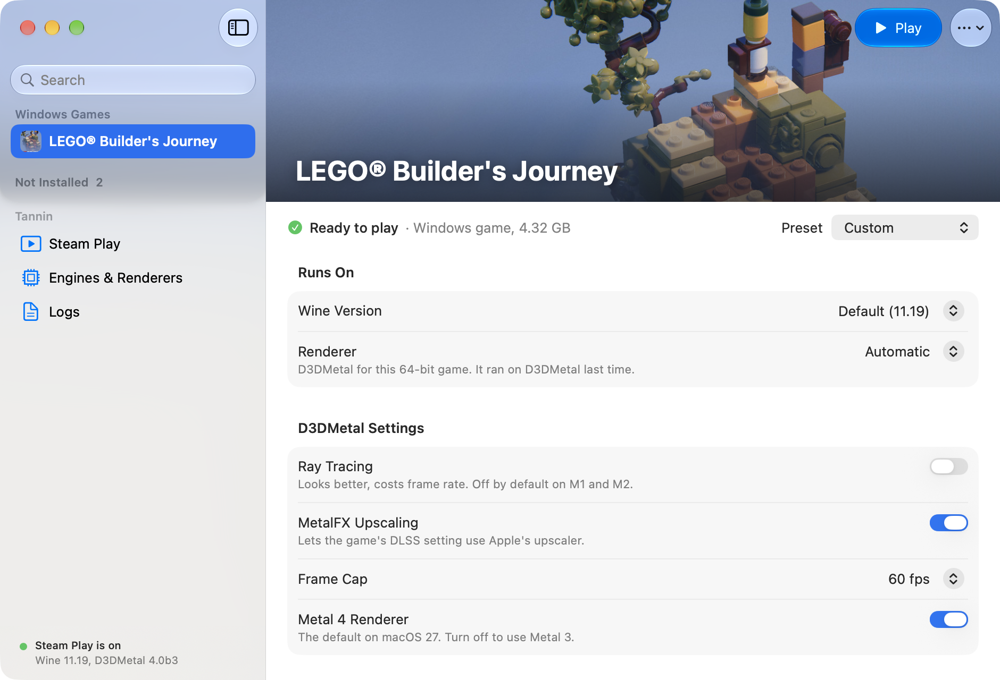

<p align="center">
  
</p>

<h1 align="center">Tannin</h1>

<p align="center">
  Install and play Windows games from the Steam you already have on your Mac.<br>
  Free, on a free Wine engine, with a choice of graphics layers.
</p>

<p align="center">
  <picture>
    <source media="(prefers-color-scheme: dark)" srcset="docs/screenshots/game-dark.png">
    
  </picture>
</p>

> [!WARNING]
> **Early test build.** Three games have been tried on one Mac, and two of them start. Expect rough
> edges, and please report what you find. [`FINDINGS.md`](FINDINGS.md) is an honest log of what has and has not been
> shown to work.

## What it does

- **Windows games show up as installable in Steam for Mac.** You press Install and Play in Steam as
  you would for a Mac game. No second Steam, no separate launcher to keep signed in.
- **A Mac app looks after the rest.** Tannin sets everything up, lists your Windows games, and gives
  each one its own settings: which graphics layer it uses, a frame cap, a performance overlay, and the
  settings that belong to that layer.
- **Three graphics layers.** Apple's D3DMetal, DXMT and DXVK. A game starts on Automatic and can be
  given another on its page.
- **Free all the way down.** A Wine engine built from CodeWeavers' published sources, the open-source
  NotProton Steam bridge and, if you want it, Apple's D3DMetal from your own copy of the Game Porting
  Toolkit. CrossOver is never used.
- **It can be undone.** One button puts Steam back exactly as Valve ships it.

## A look around

<p align="center">
  <picture>
    <source media="(prefers-color-scheme: dark)" srcset="docs/screenshots/setup-dark.png">
    
  </picture>
  <br>
  <sub>Setup is six steps, each one saying what it does. The last is the only one that changes Steam, and it asks first.</sub>
</p>

| Engine | Logs |
|:---:|:---:|
| <picture><source media="(prefers-color-scheme: dark)" srcset="docs/screenshots/engine-dark.png"></picture> | <picture><source media="(prefers-color-scheme: dark)" srcset="docs/screenshots/logs-dark.png"></picture> |
| What is installed, at which version, and the button that removes Steam Play again. | What the Steam add-on did, with one button that copies everything a bug report needs. |

## What you need

- A Mac with Apple silicon, on **macOS 26 or later**.
- **Steam for Mac**, in your Applications folder, signed in at least once.
- About 2 GB of free disk space, before any games.
- Optional: Apple's **Game Porting Toolkit** disk image, for games that use Direct3D 12. It is free
  with an Apple account:
  [download it from Apple](https://developer.apple.com/download/all/?q=game%20porting%20toolkit)
  ("Evaluation environment for Windows games", 4.0 beta 3 or newer). Tannin never includes it.

## Install

1. Download `Tannin-<version>.zip` from the [Releases page](https://github.com/lantelyes/tannin/releases) and open it.
2. Move **Tannin** to your Applications folder and open it.
3. macOS will say it could not verify Tannin, because this build is not signed with an Apple developer
   certificate. Open **System Settings › Privacy & Security**, scroll down, and click **Open Anyway**.
   You only do this once.
4. Follow **Set Up Tannin**. It downloads the Wine engine and the Steam bridge (about 550 MB) and last
   of all asks before it adds Steam Play to Steam. When macOS asks whether Tannin may change other
   apps, allow it.
5. Optional: add Apple's Game Porting Toolkit, in setup or later on the Engine page. Games that use
   Direct3D 12 need it.

Then install a Windows game from your Steam library and press Play, in Steam or in Tannin.

## Updating

From version 0.2.0 Tannin updates itself. It checks once a day and always asks before it installs
anything; **Tannin › Check for Updates…** checks straight away, and the daily check can be turned off
in Settings. Each update is signed, and Tannin refuses one whose signature does not match.

Tannin can only update itself from the Applications folder. If you open it from somewhere else, such
as Downloads, it offers to move itself there. What changed in each version is in
[`CHANGELOG.md`](CHANGELOG.md).

When an update brings something for what Tannin installed earlier, a **Finish Updating** row appears in
the sidebar. It leads to the Engine page, where each thing has its own button; nothing is downloaded
and Steam is not touched until you press one.

## Wine versions

Tannin installs the newest Wine engine it has been tested with. From 0.4.0 the Engine page also lists
the one before it, and **Install** adds it beside the first. A game then has a **Wine Version** row on
its page: "Default", or a version of its own.

Before a game moves to another version Tannin keeps a copy of its Windows environment, and
**More › Restore Windows Environment…** puts that copy back. Only engines that come with Tannin can
be installed: each needs its own Steam bridge patch, which is checked against a pinned hash.

## Graphics layers

| Layer | Covers | Where it comes from |
|---|---|---|
| D3DMetal | Direct3D 11 and 12, 64-bit games | Apple's Game Porting Toolkit, from your own download |
| DXMT | Direct3D 10 and 11, 32-bit and 64-bit games | Inside the Wine engine |
| DXVK | Direct3D 11 through Vulkan, 64-bit games | Inside the Wine engine |

A game starts on **Automatic**: D3DMetal for a 64-bit game when the toolkit has been added, DXMT
otherwise. Direct3D 9 games stay on Wine's own layer. The choice is kept in the game's Steam launch
options, so it holds with Tannin closed; anything you typed there yourself is left alone.

## What it changes in Steam, and how to undo it

Tannin adds one file to `Steam.app`, changes two lines of its settings and signs Steam again on your
Mac, so that Steam loads the add-on that makes Windows games installable. **Valve does not support
this.** It also stops Steam updating itself, because a Steam update turns the add-on off.

To undo it, open Tannin and choose **Engine › Remove Steam Play**. Steam is replaced with a copy
signed by Valve, and Tannin checks that signature first. Your games, saves and account are not touched.

## Known limits

- **Direct3D 12** games need Apple's Game Porting Toolkit.
- **Direct3D 9** games run on Wine's own, slower graphics layer.
- **Old games that want a 4:3 screen**, such as 1024 × 768, cannot have it full screen on a Mac whose
  display has no such mode. From 0.5.0, **Fixed Window** on the game's page runs them in a window of
  that size instead.
- **32-bit games** now reach Steam. Their Steam overlay, achievements and cloud saves have not been
  checked yet.
- **Steam updates.** When Steam moves to a build the Steam bridge does not know yet, Steam Play stays
  off until Tannin catches up. Tannin tells you when that has happened. Mac games are not affected.
- **Permissions after an update.** Because this build is only signed locally, macOS may ask for its
  permissions again each time you install a new version of Tannin.
- Not every game runs. Anti-cheat that needs Windows kernel drivers does not work under Wine.

## What it is made of

| Piece | Source | How Tannin gets it |
|---|---|---|
| Steam add-on and Steam bridge | [NotProton](https://github.com/NotProtonNot/NotProton) 1.2.6 | Downloaded, SHA-256 pinned |
| Wine engine | [winecx-gptk](https://github.com/frankea/winecx-gptk) 4.8.3 (Wine 11.19, CrossOver 26.3 sources) | Downloaded, SHA-256 pinned |
| Second Wine engine (optional) | [winecx-gptk](https://github.com/dappermint/winecx-gptk) 4.7.3 (Wine 11.17) | Downloaded when you ask for it, SHA-256 pinned |
| D3DMetal (optional) | Apple Game Porting Toolkit 4 | You download it from Apple; Tannin imports it and checks Apple's signature |
| DXMT 0.80, DXVK 1.10.3 | [DXMT](https://github.com/3Shain/dxmt), [DXVK](https://github.com/doitsujin/dxvk) | Part of the Wine engine download |
| Steam client files | Valve | Downloaded from Valve's servers, SHA-256 pinned |

Nothing is used before its hash has been checked.

## Build it yourself

```sh
swift build
swift test
scripts/bundle.sh        # build/Tannin.app
scripts/package.sh       # dist/Tannin-<version>.zip
scripts/release.sh 0.5.0 --dry-run   # everything a release does, short of publishing
.build/debug/tannin doctor
```

A copy you build yourself has no update feed, so it does not check for updates. Releases are made by
`scripts/release.sh` on the maintainer's Mac, which holds the key that signs them; the tests run on
GitHub for every push.

Needs Xcode's Swift toolchain (Swift 6.2 or later). The command line tool `tannin` does everything
the app does.

## Licence

GPL-3.0. See [`LICENSE`](LICENSE) and [`NOTICE`](NOTICE), which credits the projects Tannin builds on,
including [Sparkle](https://sparkle-project.org), which does the updating.

Tannin is not affiliated with or endorsed by Valve, Apple or CodeWeavers. Steam is a trademark of
Valve Corporation. Game artwork in the screenshots belongs to its publishers.
