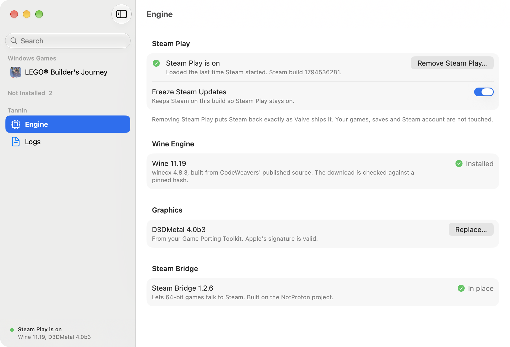
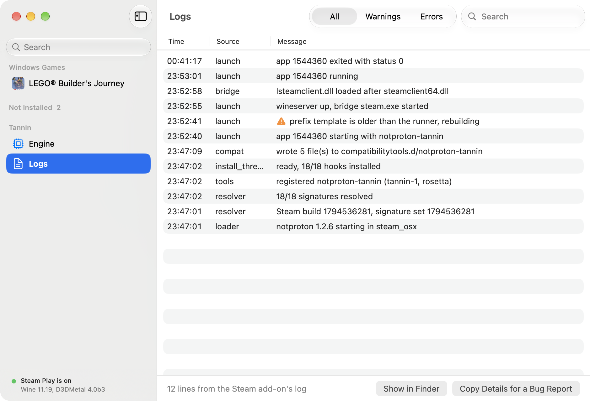

<p align="center">
  
</p>

<h1 align="center">Tannin</h1>

<p align="center">
  Install and play Windows games from the Steam you already have on your Mac.<br>
  Free, on a free Wine engine and Apple's own graphics translator.
</p>

<p align="center">
  <picture>
    <source media="(prefers-color-scheme: dark)" srcset="docs/screenshots/game-dark.png">
    
  </picture>
</p>

> [!WARNING]
> **Early test build.** One game has been run end to end on one Mac. Expect rough edges, and please
> report what you find. [`FINDINGS.md`](FINDINGS.md) is an honest log of what has and has not been
> shown to work.

## What it does

- **Windows games show up as installable in Steam for Mac.** You press Install and Play in Steam as
  you would for a Mac game. No second Steam, no separate launcher to keep signed in.
- **A Mac app looks after the rest.** Tannin sets everything up, lists your Windows games, and gives
  each one its own settings: ray tracing, MetalFX upscaling, a frame cap and a performance overlay.
- **Free all the way down.** A Wine engine built from CodeWeavers' published sources, Apple's D3DMetal
  from your own copy of the Game Porting Toolkit, and the open-source NotProton Steam bridge. CrossOver
  is never used.
- **It can be undone.** One button puts Steam back exactly as Valve ships it.

## A look around

<p align="center">
  <picture>
    <source media="(prefers-color-scheme: dark)" srcset="docs/screenshots/setup-dark.png">
    
  </picture>
  <br>
  <sub>Setup is six steps, each one saying what it does. The last is the only one that changes Steam, and it asks first.</sub>
</p>

| Engine | Logs |
|:---:|:---:|
| <picture><source media="(prefers-color-scheme: dark)" srcset="docs/screenshots/engine-dark.png"></picture> | <picture><source media="(prefers-color-scheme: dark)" srcset="docs/screenshots/logs-dark.png"></picture> |
| What is installed, at which version, and the button that removes Steam Play again. | What the Steam add-on did, with one button that copies everything a bug report needs. |

## What you need

- A Mac with Apple silicon, on **macOS 26 or later**.
- **Steam for Mac**, in your Applications folder, signed in at least once.
- Apple's **Game Porting Toolkit** disk image. It is free with an Apple account:
  [download it from Apple](https://developer.apple.com/download/all/?q=game%20porting%20toolkit)
  ("Evaluation environment for Windows games", 4.0 beta 3 or newer). Tannin never includes it.
- About 2 GB of free disk space, before any games.

## Install

1. Download `Tannin-<version>.zip` from the [Releases page](https://github.com/lantelyes/tannin/releases) and open it.
2. Move **Tannin** to your Applications folder and open it.
3. macOS will say it could not verify Tannin, because this build is not signed with an Apple developer
   certificate. Open **System Settings › Privacy & Security**, scroll down, and click **Open Anyway**.
   You only do this once.
4. Follow **Set Up Tannin**. It downloads the Wine engine and the Steam bridge (about 550 MB), asks
   for the Game Porting Toolkit disk image, and last of all asks before it adds Steam Play to Steam.
   When macOS asks whether Tannin may change other apps, allow it.

Then install a Windows game from your Steam library and press Play, in Steam or in Tannin.

## What it changes in Steam, and how to undo it

Tannin adds one file to `Steam.app`, changes two lines of its settings and signs Steam again on your
Mac, so that Steam loads the add-on that makes Windows games installable. **Valve does not support
this.** It also stops Steam updating itself, because a Steam update turns the add-on off.

To undo it, open Tannin and choose **Engine › Remove Steam Play**. Steam is replaced with a copy
signed by Valve, and Tannin checks that signature first. Your games, saves and account are not touched.

## Known limits

- **32-bit games** start, but have no Steam overlay, achievements or cloud saves.
- **Steam updates.** When Steam moves to a build the Steam bridge does not know yet, Steam Play stays
  off until Tannin catches up. Tannin tells you when that has happened. Mac games are not affected.
- **Permissions after an update.** Because this build is only signed locally, macOS may ask for its
  permissions again each time you install a new version of Tannin.
- Not every game runs. Anti-cheat that needs Windows kernel drivers does not work under Wine.

## What it is made of

| Piece | Source | How Tannin gets it |
|---|---|---|
| Steam add-on and Steam bridge | [NotProton](https://github.com/NotProtonNot/NotProton) 1.2.6 | Downloaded, SHA-256 pinned |
| Wine engine | [winecx-gptk](https://github.com/frankea/winecx-gptk) 4.8.3 (Wine 11.19, CrossOver 26.3 sources) | Downloaded, SHA-256 pinned |
| D3DMetal | Apple Game Porting Toolkit 4 | You download it from Apple; Tannin imports it and checks Apple's signature |
| Steam client files | Valve | Downloaded from Valve's servers, SHA-256 pinned |

Nothing is used before its hash has been checked.

## Build it yourself

```sh
swift build
swift test
scripts/bundle.sh        # build/Tannin.app
scripts/package.sh       # dist/Tannin-<version>.zip, for a release
.build/debug/tannin doctor
```

Needs Xcode's Swift toolchain (Swift 6.2 or later). The command line tool `tannin` does everything
the app does.

## Licence

GPL-3.0. See [`LICENSE`](LICENSE) and [`NOTICE`](NOTICE), which credits the projects Tannin builds on.

Tannin is not affiliated with or endorsed by Valve, Apple or CodeWeavers. Steam is a trademark of
Valve Corporation. Game artwork in the screenshots belongs to its publishers.
