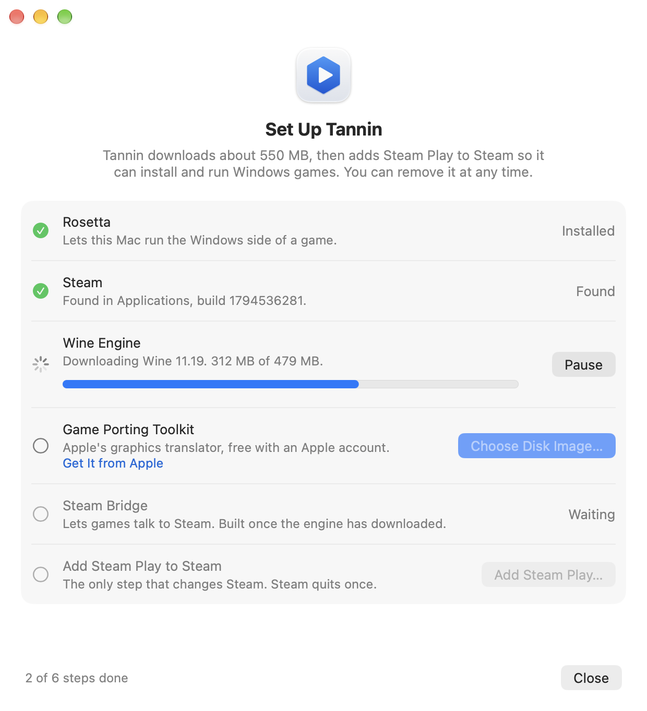
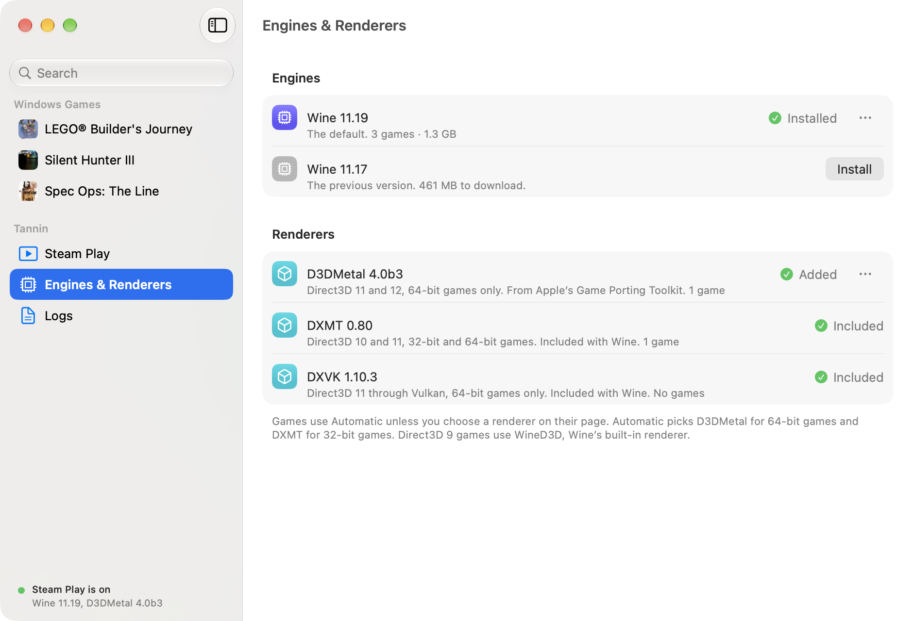
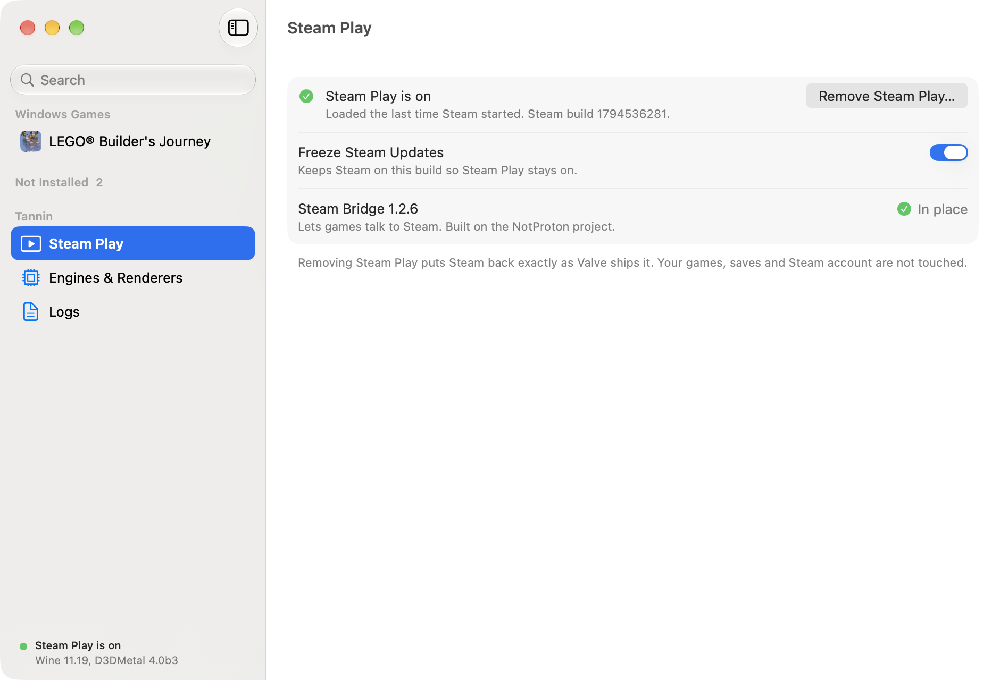

<p align="center">
  
</p>

<h1 align="center">Tannin</h1>

<p align="center">
  Install and play Windows games from Steam for Mac.<br>
  Free and open source.
</p>

<p align="center">
  <picture>
    <source media="(prefers-color-scheme: dark)" srcset="docs/screenshots/game-dark.png">
    
  </picture>
</p>

> [!WARNING]
> Early test build, tried so far with three games on one Mac. Expect bugs, and please report them.
> [`FINDINGS.md`](FINDINGS.md) lists what has and hasn't been tested.

## What it does

- Windows games in your Steam library get an Install button, and you install and play them in Steam
  like Mac games. There's no second copy of Steam to sign in to.
- The Tannin app handles setup and gives each game a page where you choose its Wine version,
  renderer, and graphics settings.
- Games can run on Apple's D3DMetal, DXMT, or DXVK. Tannin picks one automatically, and you can
  change it per game.
- Everything Tannin uses is free: a Wine build from CodeWeavers' published source, the open-source
  NotProton bridge, and optionally Apple's D3DMetal from your own Game Porting Toolkit download. It
  doesn't use CrossOver.
- One button removes Steam Play and restores Valve's original Steam.

## A look around

<p align="center">
  <picture>
    <source media="(prefers-color-scheme: dark)" srcset="docs/screenshots/setup-dark.png">
    
  </picture>
  <br>
  <sub>Setup is one window. It asks before the last step, which adds Steam Play to Steam.</sub>
</p>

| Engines & Renderers | Steam Play |
|:---:|:---:|
| <picture><source media="(prefers-color-scheme: dark)" srcset="docs/screenshots/renderers-dark.png"></picture> | <picture><source media="(prefers-color-scheme: dark)" srcset="docs/screenshots/steam-play-dark.png"></picture> |
| Your Wine versions and renderers, and how many games use each. | Add or remove Steam Play, and freeze Steam updates. |

<p align="center">
  <picture>
    <source media="(prefers-color-scheme: dark)" srcset="docs/screenshots/logs-dark.png">
    
  </picture>
  <br>
  <sub>Logs from the Steam add-on. Copy Bug Report copies everything a bug report needs.</sub>
</p>

## What you need

- A Mac with Apple silicon running macOS 26 or later.
- Steam for Mac in your Applications folder, signed in at least once.
- About 2 GB of free disk space, before any games.
- Optional: Apple's D3DMetal, for Direct3D 12 games. It's part of the Game Porting Toolkit, a free
  download with an Apple Account.
  [Download it from Apple](https://developer.apple.com/download/all/?q=game%20porting%20toolkit)
  ("Evaluation environment for Windows games", 4.0 beta 3 or newer). Tannin doesn't include it.

## Install

1. Download `Tannin-<version>.zip` from the [Releases page](https://github.com/lantelyes/tannin/releases),
   unzip it, and drag Tannin to your Applications folder.
2. Open Tannin. macOS blocks it the first time because the app isn't notarized. Go to
   **System Settings > Privacy & Security**, scroll down, and click **Open Anyway**.
3. Click **Set Up**. Tannin downloads Wine and the Steam bridge (about 650 MB), then asks before it
   adds Steam Play to Steam. If macOS blocks that step, turn on Tannin in
   **System Settings > Privacy & Security > App Management** and add Steam Play again.
4. Optional: for Direct3D 12 games, add Apple's D3DMetal in **Engines & Renderers** or from a game's
   Renderer pop-up.

Then install a Windows game from your Steam library and click Play.

## Updating

Tannin checks for updates once a day and asks before installing. To check now, choose
**Tannin > Check for Updates**. You can turn off the daily check in Settings. Updates are signed, and
Tannin rejects any update with a bad signature.

Tannin can only update itself from the Applications folder. If you open it from somewhere else, such
as Downloads, it offers to move itself. [`CHANGELOG.md`](CHANGELOG.md) lists what changed in each
version.

Some updates add to what Tannin already installed. When that happens, a **Finish Updating** row
appears in the sidebar and takes you to the Steam Play page, where each addition has its own button.
Tannin doesn't download anything or change Steam until you click one.

## Wine versions

Tannin installs the latest Wine version it's been tested with. **Engines & Renderers** also lists the
previous version, which you can install alongside it. Each game's page has a **Wine Version** pop-up
where you can leave the game on the default or give it its own version. If you pick a version that
isn't installed, Tannin downloads it while Steam stays open, then asks before switching the game.

Before a game switches versions, Tannin backs up its Windows environment. To go back, choose
**More > Restore Windows Environment** on the game's page. You can only install the Wine versions that
come with Tannin, because each one needs its own Steam bridge patch, which is checked against a pinned
hash.

## Renderers

A renderer translates a game's Direct3D calls to Metal, the Mac's graphics API.

| Renderer | Supports | Source |
|---|---|---|
| D3DMetal | Direct3D 11 and 12, 64-bit games only | Apple's Game Porting Toolkit, from your own download |
| DXMT | Direct3D 10 and 11, 32-bit and 64-bit games | Included with Wine |
| DXVK | Direct3D 11 through Vulkan, 64-bit games only | Included with Wine |

Games start on **Automatic**, which picks D3DMetal for 64-bit games if you've added it and DXMT
otherwise. Direct3D 9 games use WineD3D, Wine's built-in renderer. Your choice is stored in the game's
Steam launch options, so it applies even when Tannin is closed. Tannin leaves any launch options you
typed yourself.

You add, replace, and remove D3DMetal in **Engines & Renderers**. Tannin verifies Apple's signature,
copies only D3DMetal, and doesn't change the disk image.

## Known limits

- Direct3D 12 games need Apple's D3DMetal.
- Direct3D 9 games run on WineD3D, which is slower.
- Older games that need a 4:3 resolution such as 1024 × 768 can't run full screen on a Mac display.
  Turn on Fixed Window on the game's page to run them in a window of that size.
- The Steam overlay, achievements, and cloud saves haven't been tested with 32-bit games.
- When Steam updates to a build Tannin doesn't support yet, Steam Play turns off until Tannin is
  updated, and Tannin tells you. Mac games keep working.
- Tannin is signed locally and isn't notarized, so macOS may ask for its permissions again after each
  Tannin update.
- Games with kernel-level anti-cheat don't run.

## What it's made of

| Component | Source | How Tannin gets it |
|---|---|---|
| Steam add-on and Steam bridge | [NotProton](https://github.com/NotProtonNot/NotProton) 1.2.6 | Downloaded, SHA-256 pinned |
| Wine | [winecx-gptk](https://github.com/frankea/winecx-gptk) 4.8.3 (Wine 11.19, CrossOver 26.3 sources) | Downloaded, SHA-256 pinned |
| Second Wine version (optional) | [winecx-gptk](https://github.com/dappermint/winecx-gptk) 4.7.3 (Wine 11.17) | Downloaded when you install it, SHA-256 pinned |
| D3DMetal (optional) | Apple Game Porting Toolkit 4 | You download it from Apple. Tannin verifies Apple's signature and copies D3DMetal |
| DXMT 0.80, DXVK 1.10.3 | [DXMT](https://github.com/3Shain/dxmt), [DXVK](https://github.com/doitsujin/dxvk) | Included in the Wine download |
| Steam client files | Valve | Downloaded from Valve's servers, SHA-256 pinned |
| The seven covers in the setup window | Valve's Steam servers | Downloaded when the setup window first opens (about 450 KB) and saved on your Mac. If Steam already has a cover, Tannin uses that copy |

Tannin verifies each download's hash before using it. The seven covers are the exception. They're only
displayed, and if Valve replaces one, Tannin shows the new image.

## Build it yourself

```sh
swift build
swift test
scripts/bundle.sh        # build/Tannin.app
scripts/package.sh       # dist/Tannin-<version>.zip
scripts/preview-site.sh  # the website as the next release would publish it, served on this Mac
scripts/release.sh <version> --dry-run   # everything a release does, short of publishing
.build/debug/tannin doctor
```

Build with `TANNIN_NO_UPDATES=1 scripts/bundle.sh` for a copy that doesn't check for updates. Releases are made with
`scripts/release.sh` on the maintainer's Mac, which holds the signing key. Tests run on GitHub for
every push. The script only publishes after you type "yes" or repeat the version with
`--confirm <version>`.

You need Xcode's Swift toolchain (Swift 6.2 or later). The `tannin` command line tool does everything
the app does.

## License

GPL-3.0. See [`LICENSE`](LICENSE) and [`NOTICE`](NOTICE), which credits the projects Tannin builds on,
including [Sparkle](https://sparkle-project.org), which handles updates.

Tannin is not affiliated with or endorsed by Valve, Apple, or CodeWeavers. Steam is a trademark of
Valve Corporation. Game artwork in the screenshots and the setup window belongs to its publishers and
isn't part of Tannin or this repository.
